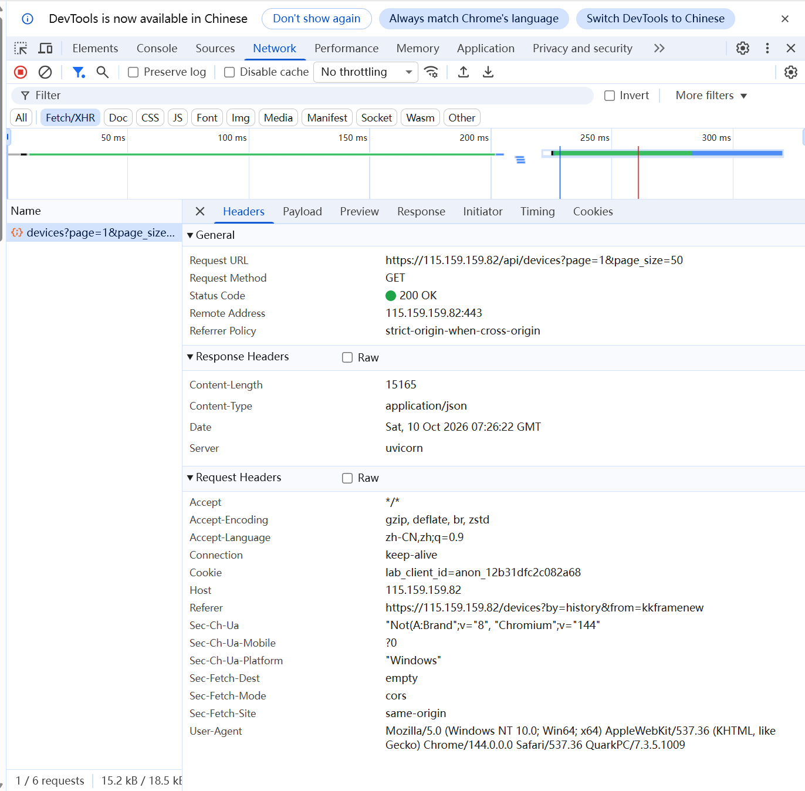
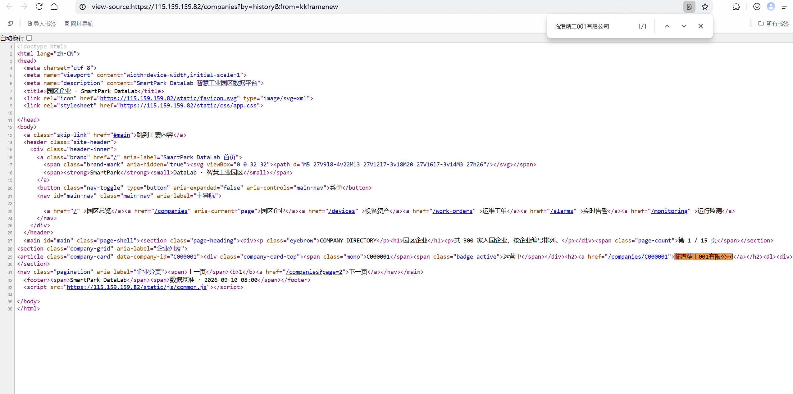
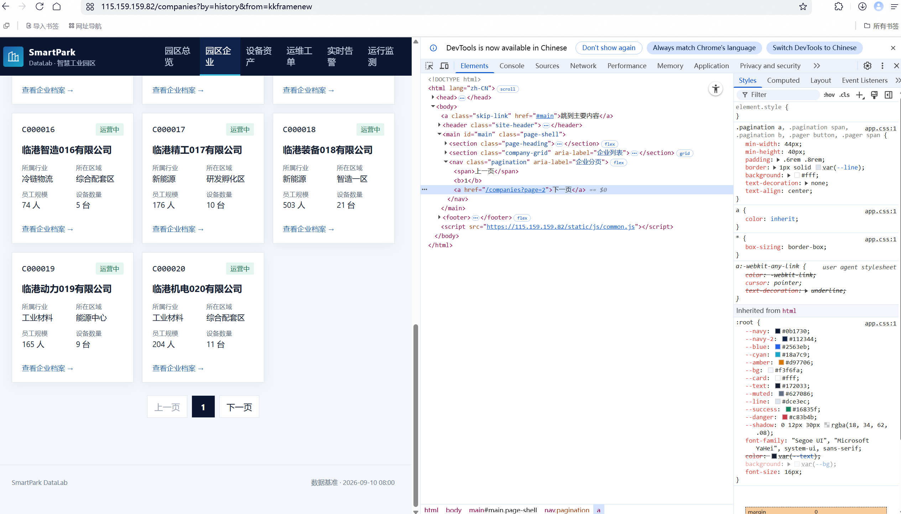
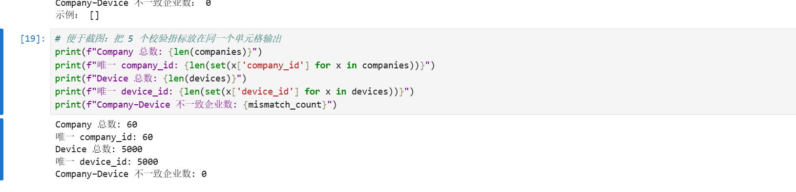

# Lab 1 实验报告

## 学生信息

- **姓名：**王岩
- **学号：**112404260120
- **班级：**数据科学与大数据技术1241
- **GitHub 用户名：**shuaigew66
- **仓库地址：**https://github.com/shuaigew66/bigdata-collection-labs-112404260120

> 文件位置：`lab01/REPORT.md`
> 完整代码保存在 `lab1_html_api.ipynb`。
> 本报告只填写关键发现、关键代码、结果和指定截图。

---

# 任务 1：判断数据加载方式

## 1.1 Device：判断动态加载并找到 API

### 判断结果

- 页面：`/devices`
- 数据加载方式：**动态加载**
- 判断依据：

在 `/devices` 的"查看网页源代码"中**搜索不到页面上任何一条真实设备数据**：设备编号 `D00000001`、设备名 `循环泵-000001-001` 都不存在于源码里；页面明明有设备表格，但源码中表格数据区只有一行占位内容：

```html
<tbody id="device-rows"><tr><td colspan="8" class="loading-cell">正在加载…</td></tr></tbody>
```

页面末尾加载的 `/static/js/devices.js` 内部执行 `fetch('/api/devices?...')` 来填充表格。随后在 `F12 → Network → Fetch/XHR` 中刷新页面，确实抓到了这条返回设备 JSON 的请求。

> 补充：源码中能搜到"循环泵"一词，但它出现在筛选表单的设备类型下拉框里（`<option value="pump">循环泵</option>`），是**类型标签**而不是设备记录，不能作为"静态加载"的证据。

### API 信息

- Request URL：`https://115.159.159.82/api/devices?page=1&page_size=50`
- Request Method：`GET`
- Query 参数：

| 参数 | 含义 | 本实验取值 |
|---|---|---|
| `page` | 页码，从 1 开始 | `1, 2, …, 100` |
| `page_size` | 每页返回条数 | `50`（页面自带脚本用的就是 50） |

- 响应：`Content-Type: application/json`，结构为 `{"page":…, "page_size":…, "total":…, "items":[…]}`

### 【截图 1】Device API 发现证据

在浏览器 DevTools 的 **Network → Fetch/XHR** 面板中，选中 `devices?page=1&page_size=50` 请求，右侧 **Headers** 中的 `Request URL` 与分页参数 `page`、`page_size` 均可见：



---

## 1.2 Company：判断静态加载

- 页面：`/companies`
- 数据加载方式：**静态加载**
- 判断依据：

使用"右键 → 查看网页源代码"后，按 `Ctrl + F` 搜索页面上真实显示的企业名称（例如 **临港精工001有限公司**），**在源代码中直接就能搜到**，说明企业记录是随初始 HTML 一起返回的，不需要再发额外的数据请求。因此可以直接按静态页面处理：

```text
requests → r.text → BeautifulSoup → CSS Selector
```

### 【截图 2】Company 静态加载证据

在「查看网页源代码」（地址栏以 `view-source:` 开头）页面中按 `Ctrl + F` 搜索真实企业名称 `临港精工001有限公司` 并命中，同一段可见 `<article class="company-card" data-company-id="C000001">`，证明企业记录随初始 HTML 一起返回：



---

# 任务 2：Device API 分页采集

## 2.1 API 分页结构

| 含义 | JSON 字段 |
|---|---|
| 当前页 | `page` |
| 每页条数 | `page_size` |
| 设备总数 | `total` |
| 设备列表 | `items` |

## 2.2 关键代码

```python
# 从第一页响应中读取分页信息
total = data["total"]
page_size = data["page_size"]

total_pages = (total + page_size - 1) // page_size

devices = []

for page in range(1, total_pages + 1):
    r = requests.get(
        api_url,
        params={
            "page": page,
            "page_size": page_size
        },
        timeout=10
    )

    page_data = r.json()
    page_items = page_data["items"]
    devices.extend(page_items)          # 把本页设备并入总列表
```

## 2.3 采集结果

- 每页条数：**50**
- 设备总数：**5000**
- 程序计算得到的总页数：**100**（`(5000 + 50 - 1) // 50`）
- 最终采集设备数：**5000**
- 唯一 `device_id` 数：**5000**

回答：

> 为什么总页数应由 API 返回的 `total` 和 `page_size` 计算，而不是直接在代码里写死？

答：`total` 是**服务端当前的真实数据量**，`page_size` 是**本次请求实际生效的每页条数**。把页数写死（例如写 `range(1, 101)`）会有三个问题：一是数据一更新页数就对不上，写多了会请求到空页、写少了会漏采；二是每页条数一旦调整（比如服务端把上限改成 20），写死的页数就会漏掉大量数据；三是代码换到另一个数据量不同的接口上完全不能复用。用 `(total + page_size - 1) // page_size` 计算是"向上取整"的标准写法，能自动适应最后一页不满的情况，让采集逻辑与数据量解耦。

---

# 任务 3：Company HTML 解析

## 3.1 企业记录 Selector

- 企业记录 selector：`article.company-card`
- 第 1 页企业记录数：**20**

说明为什么选择这个 selector：

- 主要使用了 `id / class / data-* / 父子层级` 中的哪一种？

  主要用了 **class**，并辅以 **标签名**。每家企业是一个 `<article class="company-card" data-company-id="C000001">`，`company-card` 这个 class 语义明确、全页每家企业各出现一次，正好对应"一条完整企业记录"。

- 是否参考过浏览器 Copy selector 或 AI？

  参考过浏览器的 `Copy selector` 作为对照。它直接给出的是带 `nth-child(...)` 的长路径（形如 `body > main > section.company-grid > article:nth-child(1)`），虽然能命中，但把位置信息写进了选择器里，页面结构一变就失效，所以最终没有采用。

- 最终为什么采用现在这个写法？

  因为它**短、语义明确、对位置不敏感**。`article.company-card` 只依赖标签名和 class，无论企业卡片在页面上排第几、页面顶部加了什么元素，都能稳定匹配到全部 20 条记录。这符合"优先选短、语义明确、对结构变化不敏感"的取舍原则。

## 3.2 关键代码

```python
cards = soup.select("article.company-card")

card = cards[0]

company_id = card.get("data-company-id")                     # 来自 HTML 属性
name = card.select_one("h2 a").get_text(strip=True)          # 来自文本
status = card.select_one("span.badge").get_text(strip=True)  # 来自文本
```

行业、区域、设备数量使用 `dt/dd` 结构后，先整条转成字典，再按 `dt` 文本取 `dd` 值：

```python
details = {}
for item in card.select("dl > div"):
    key = item.select_one("dt").get_text(strip=True)
    value = item.select_one("dd").get_text(strip=True)
    details[key] = value

industry = details["所属行业"]                                  # 汽车零部件
zone = details["所在区域"]                                      # 智造一区
device_count = int(re.search(r"\d+", details["设备数量"]).group())  # "6 台" → 6
```

> 说明：`device_count` 的 `dd` 文本形如 `"6 台"`，先用 `re.search(r"\d+", …)` 取出数字再转 `int`，这样即使数字后面跟了单位或空格也不会出错。

## 3.3 字段来源说明

1. 字段：**`company_id`**
   - 来自：**HTML 属性**
   - 使用的方法：用 `card.get("data-company-id")` 读取记录最外层 `article` 上的 `data-*` 属性。它本来就是结构化标识，直接取属性值最准确，也避免了从文本里再切字符串。

2. 字段：**`device_count`**
   - 来自：**文本**
   - 使用的方法：该值在记录内部的 `dl > div > dd` 里，文本形如 `"6 台"`。先用 `item.select_one("dd").get_text(strip=True)` 拿到文本，再用 `re.search(r"\d+", …).group()` 抽出数字并转为整数，便于后续与 Device 数据做数量比对。

---

# 任务 4：Company "下一页"分页

## 4.1 下一页元素

- "下一页" selector：`nav.pagination a:last-of-type`
- 第 1 页 `href` 示例：`/companies?page=2`

页面底部的分页区结构如下，其中"下一页"是一个 `<a>` 标签，**没有 id、也没有独立 class**：

```html
<nav class="pagination" aria-label="企业分页">
  <span>上一页</span><b>1</b><a href="/companies?page=2">下一页</a>
</nav>
```

由于缺乏 id / class，最终采用**父子层级 + 位置**定位：先由语义明确的 `nav.pagination` 锁定分页区，再用 `a:last-of-type` 取其中最后一个链接（即"下一页"）。代码里还会校验 `get_text() == "下一页"` 兜底，避免在最后一页误取。

### 【截图 3】Company "下一页"元素

DevTools → **Elements** 面板中高亮选中的正是 `<a href="/companies?page=2">下一页</a>`（`== $0`），底部面包屑显示其位于 `nav.pagination` 内部，与该元素没有 id / 独立 class、只能用父子层级定位的结论一致：



---

## 4.2 关键代码

```python
next_link = soup.select_one("nav.pagination a:last-of-type")

next_href = next_link.get("href")        # "/companies?page=2"

next_url = urljoin(
    current_url,
    next_link.get("href")
)                                        # https://115.159.159.82/companies?page=2
```

> 你的程序如何完成"当前页 → 找下一页 href → 请求下一页 → 再解析"的循环？

答：循环开始前先把 `current_url` 设为 `https://115.159.159.82/companies`。每一轮里，① 用 `requests.get(current_url)` 请求当前页；② 交给 BeautifulSoup，用 `soup.select("article.company-card")` 解析出本页 20 条企业并追加到 `companies`；③ 再用 `nav.pagination a:last-of-type` 找到"下一页"链接，读出它的 `href`。因为 `href` 是相对路径（`/companies?page=2`），所以用 `urljoin(current_url, href)` 拼成绝对地址，并赋值回 `current_url`，作为下一轮的请求地址。循环体固定跑 3 轮，同时加了"如果取不到下一页或者文本不是'下一页'就 break"的保护，避免越界请求。

---

## 4.3 三页采集结果

| 页码 | 企业数 |
|---|---:|
| 1 | 20 |
| 2 | 20 |
| 3 | 20 |
| **合计** | **60** |

- 唯一 `company_id` 数：**60**

> 采集 URL 依次为：`/companies` → `/companies?page=2` → `/companies?page=3`。
> 第 2 页首个编号 `C000021`，第 3 页首个编号 `C000041`，说明分页链接确实跳到了新的数据，没有重复解析同一页。

---

# 任务 5：结果验证

## 5.1 最终结果

| 检查项 | 结果 |
|---|---:|
| Company 总数 | 60 |
| 唯一 `company_id` | 60 |
| Device 总数 | 5000 |
| 唯一 `device_id` | 5000 |
| Company–Device 不一致企业数 | 0 |

### 【截图 4】最终验证结果

JupyterLab 中运行 `lab1_html_api.ipynb`，最终的校验单元格同时输出 5 项指标：Company 总数 **60**、唯一 `company_id` **60**、Device 总数 **5000**、唯一 `device_id` **5000**、Company–Device 不一致企业数 **0**：



---

## 5.2 一致性检查关键代码

```python
from collections import Counter

device_counts = Counter(
    x["company_id"] for x in devices
)

mismatch_count = 0

for company in companies:
    cid = company["company_id"]           # 企业编号
    expected = company["device_count"]    # 企业页面上的设备数量
    actual = device_counts.get(cid, 0)    # 由 Device 数据统计出的实际设备数

    if expected != actual:
        mismatch_count += 1
```

回答：

> 为什么 `status_code == 200` 仍然不能说明"数据已经采集正确"？

答：`status_code == 200` 只表示**服务器成功响应了这个 HTTP 请求**，它保证的是"请求发出去并且有回包"，不保证回包内容符合预期。它管不到下面这些情况：返回的 JSON 结构变了、字段名对不上（`KeyError` 或取到 `None`）、分页参数没生效导致反复拿到同一页、总页数算错导致漏采或重复采、以及解析选择器写错导致某页只抓到 0 条。所以必须再做一层**业务层面的校验**：数量是否符合预期（60 / 5000）、ID 是否唯一（60 / 5000）、跨数据源是否自洽（Company–Device 不一致数为 0）。本实验正是用这三类检查确认数据是"正确"的，而不是只用状态码判断。

---

# 任务 6：保存采集结果

确认已经生成：

- `companies.json`：**已生成**（60 条企业记录）
- `devices.json`：**已生成**（5000 条设备记录）

> 保存位置：`lab01/data/companies.json`、`lab01/data/devices.json`，均为 UTF-8 编码、`indent=2` 的可读 JSON。

---

# 实验结论

静态加载与动态加载页面的处理方式不同：静态页面的数据随初始 HTML 一起返回，可以直接 `requests` 取 HTML 再用 BeautifulSoup 配合 CSS Selector 解析；动态页面的数据不在初始 HTML 中，需要先通过 Network 的 Fetch/XHR 找到真正的 API，再请求 JSON 接口。分页方式也不同：HTML 分页要解析"下一页"链接、拼接 URL 后循环请求，属于"顺着页面走"；API 分页则用 `page` 和 `page_size` 参数控制，页数由 `total` 计算得出，更稳定。验证方面，我用了数量核对、`device_id`/`company_id` 唯一性检查，以及 Company–Device 设备数量一致性比对（不一致为 0）来确认采集结果正确。
