# 实验二报告：房源采集与 MySQL 存储

- 班级：数据科学与大数据技术1241
- 姓名：王岩
- 学号：112404260120
- 实验日期：2026-10-27
- GitHub 仓库链接：https://github.com/shuaigew66/bigdata-collection-labs-112404260120
- 源码文件名：lab02/anjuke.ipynb
- 数据库与表：`smartpark_lab.houseinfo`
- 数据来源：在线教学站
- 访问时间及结果（若失败，填写状态码、页面标题或报错）：2026-10-27 14:20 起，GET `http://www.bspider.top/anjuke/` 返回 200。使用手册示例的极简 UA（`Mozilla/5.0`）时返回"访问验证-安居客"页；改用完整 Chrome 请求头后正常获取列表页，完成 10 页共 600 条采集。
- 快照文件来源与文件名（在线实验可写"不适用"）：不适用（在线采集完成）

> 填写要求：截图放在 `images/` 中，在对应位置插入图片。代码截图要显示文件名、行号或单元位置，用红框标出关键代码，每项写2—3句话解释。只截最终结果或只贴 AI 生成的文字，不能代替实验过程。未完成的项目写明原因，不填写预期结果，不展示个人账号密码。

## 第一阶段：MySQL Docker 更新与启动

- 本次是否需要更新：本次按更新包说明更新。`L05_MySQL_学生环境增量更新包.zip` 解压后 7 个文件 SHA256 校验全部通过；`mysql:8.4.11` 镜像经 `docker load` 导入，镜像 ID 与说明一致（sha256:85b9bf2e…）；`start-mysql.bat`、`stop-mysql.bat`、`mysql-console.bat`、`l05-mysql.ps1`、`l05-mysql-fresh-volume.yaml` 已放入课程环境目录，未覆盖 `.env`、`workspace`、`docker-compose.yml`。
- 更新或启动遇到的问题：无（`start-mysql.bat` 显示 `[PASS] L05 MySQL healthy，账号连接检查通过。`）

### 启动环境与建表

依次使用 `start-course.bat`、`start-mysql.bat`、`mysql-console.bat` 启动课程环境、数据库和 MySQL 终端。

**截图：** MySQL 启动成功提示，以及终端中 `USE smartpark_lab`、`SHOW TABLES`、`DESCRIBE houseinfo` 的执行结果。可分图。

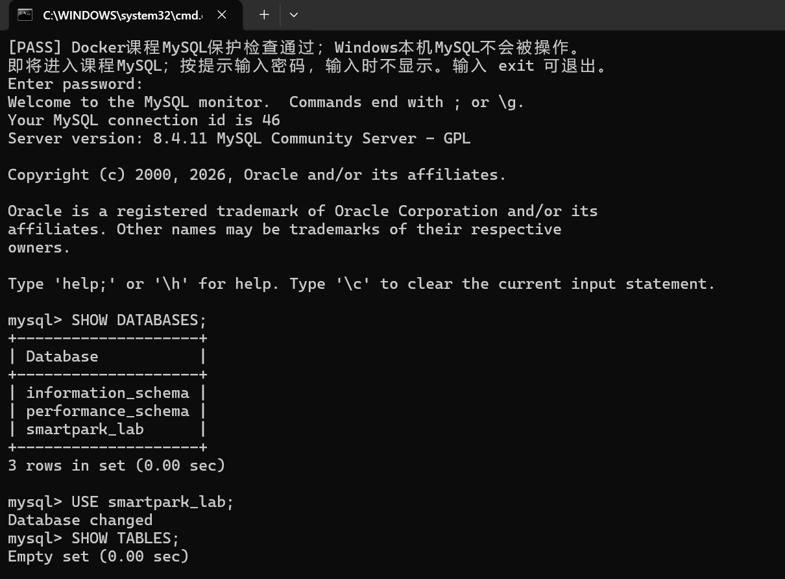

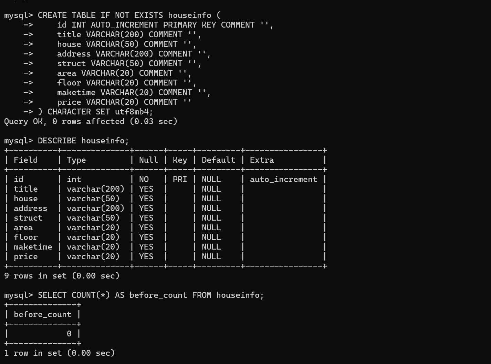

说明：当前使用哪个数据库？`id` 和8个房源字段分别保存什么？

当前使用 `smartpark_lab` 数据库中的 `houseinfo` 表。`id` 是自增长主键，由数据库自动生成，用来唯一标识一条记录；其余 8 列依次保存房源的标题（title）、楼盘（house）、地址（address）、户型（struct）、建筑面积（area）、楼层（floor）、建造年代（maketime）和每平方米单价（price），面积与单价暂保留原文字单位。

## 第二阶段：房源采集与 CSV 数据存储

### 1. 网页分析与房源解析

#### 选择器是怎样得到的

在 Chrome 中按 F12，使用 **Elements → Copy → Copy selector**。选一个字段，记录从完整路径到相对选择器的过程。

- 选择的字段：title（第一条房源的标题）
- 复制的原始选择器：`#__layout > div > section > section.list-main > section.list-left > section:nth-child(4) > div:nth-child(1) > a > div.property-content > div.property-content-detail > div.property-content-title > h3`（从 `#__layout` 根节点一路到标题 `h3`，中间带 4 处 `:nth-child()`）
- 一条房源的父容器选择器：`div.property`
- 最终使用的相对选择器：`rows = soup.select("div.property")` 选出全部房源，再在每条内用相对选择器取字段，如 `row.select_one("h3.property-content-title-name")`、`row.select_one("p.property-content-info-comm-name")`、`row.select_one("p.property-price-average")`

**截图：** 框出该字段的 HTML 节点和房源父容器，展示选择器的匹配结果。

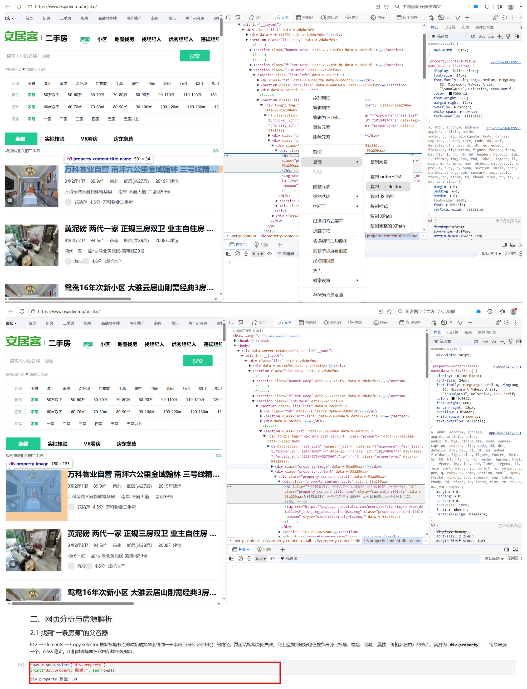

说明：删掉了哪些层级？怎样确认父容器刚好包含一条房源？

把 Copy selector 得到的从页面根节点出发、带 `:nth-child()` 的多层路径删掉，只保留"房源容器 + 容器内字段"两级，这样页面多插一个元素也不会失效。确认方法：在 Elements 中把鼠标悬停到 `div.property` 上，高亮区域刚好框住一整条房源（标题、楼盘、地址、属性、价格都在内），且每条房源的 class 相同；用 `soup.select("div.property")` 得到 60 条，与页面实际条数一致。

#### 解析8个字段

**截图：** 自己编写的解析代码和首条房源的8个字段输出。代码中必须框出：

- `select()` 和 `select_one()`。
- 面积、单价的定位与取值。
- 建造年代的提取和缺失处理。

可分成几张局部截图。另附面积、单价对应的 HTML 节点或网页原文。

下图 `parse_house()` 函数体完整保留了上述三类代码：第 3、6、10 行用 `select_one()` 取标题、楼盘、地址；`for div in row.select(...)` 先按 class 特征定位属性组，再用 `info.select(...)` 取 4 个属性项；面积/楼层/年代按内容特征识别（含"㎡"、含"层"、`re.match(r"^\d{4}年")`）；单价用 `row.select_one("p.property-price-average")` 定位；每个字段末尾的 `if el else ""` 就是缺失处理。

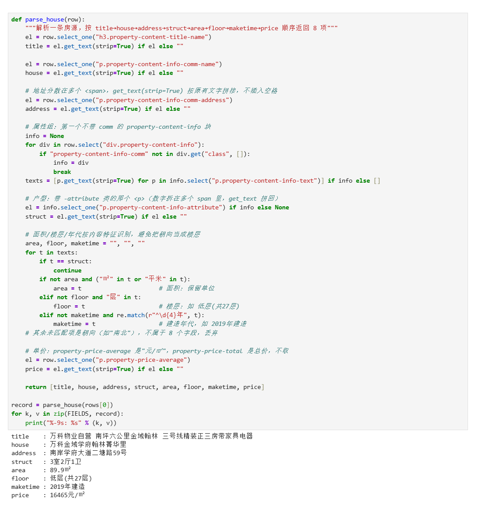

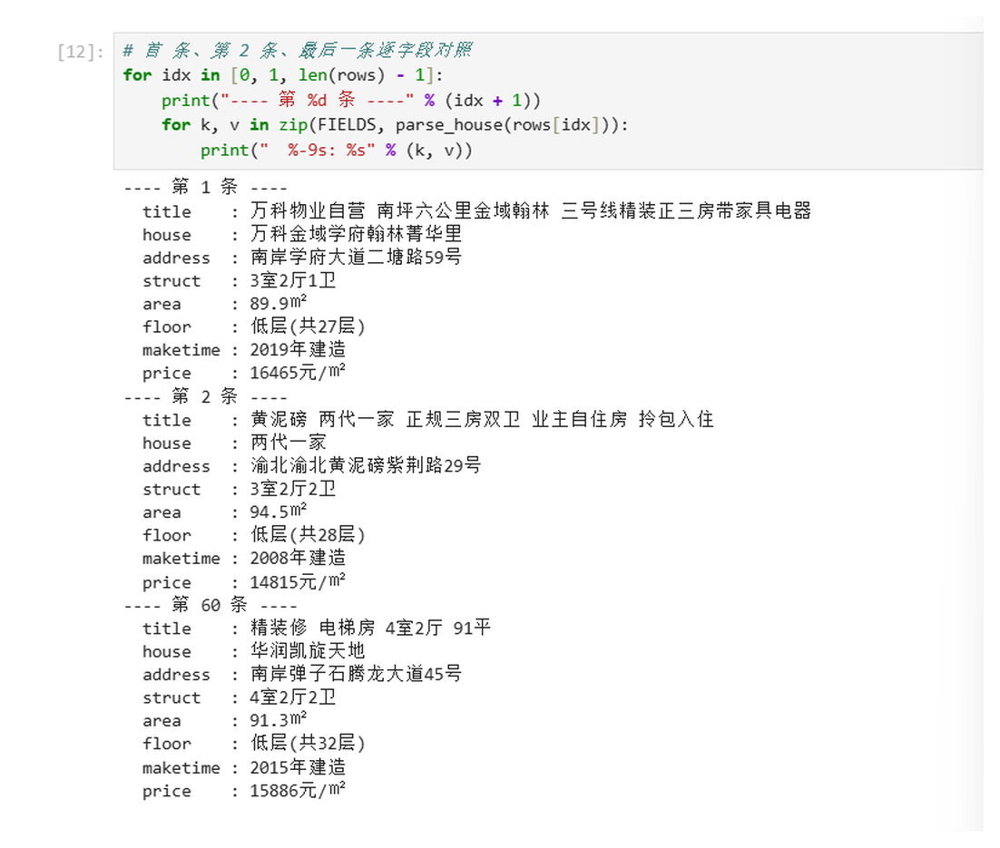

说明：两个选择方法各用在哪里？怎样确认面积和单价没有取错？

`select()` 用在整页范围选全部房源容器（返回列表），`select_one()` 用在一条房源内部取单个字段节点（返回第一个匹配，找不到返回 None）。面积取属性组中含"㎡"的文本项并保留单位（如 89.9㎡），单价取 `p.property-price-average`（如 16465元/㎡）；带"万"的 `property-price-total` 是总价，不取。解析结果与网页原文逐字对照过，首条、第2条和最后一条都核对一致。

### 2. 下一页采集

- 下一页 `href` 原值：`?page=2`
- 用 `urljoin()` 补全后的地址：`http://www.bspider.top/anjuke/?page=2`
- 实际停止原因（明确禁用的末页按钮 / 异常中止）：正常完成。第 10 页的"下一页"按钮节点仍存在，但其 class 只有 `next`、不再含 `next-active`（按钮已禁用），据此判定到达末页，采集完成。

**截图：** 框出提取 `href`、补全地址、循环更新地址和停止条件的代码。附前两页的运行日志，以及最终停止提示。离线实验展示快照中的href、补全结果和文件读取记录，注明"离线回放"，不算在线翻页成功。

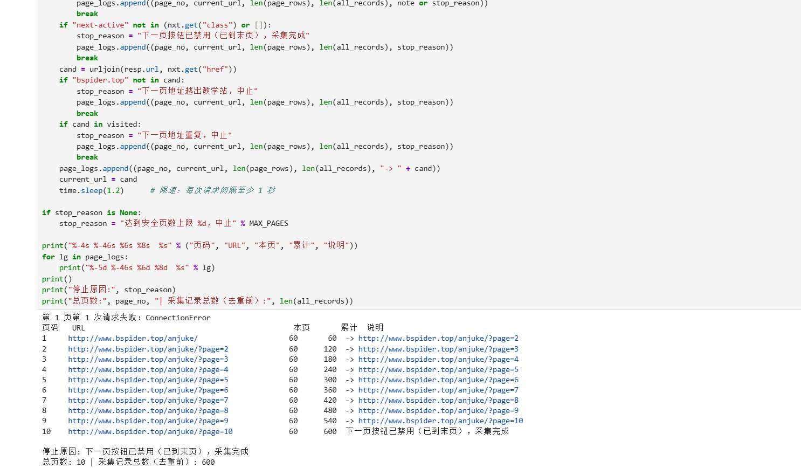

说明：怎样进入下一页？怎样防止重复采集或无限循环？若中途失败，说明停在哪一步。

每页用 `select_one("a.next")` 找下一页按钮，用 `.get("href")` 取相对地址，`urljoin(当前页URL, href)` 补全后作为下一次请求地址。防重复与防死循环：用 `visited` 集合记录访问过的地址，地址重复即中止；检查补全后地址必须包含 `bspider.top`，越出教学站即中止；另设 30 页安全上限；每次请求间隔 `time.sleep(1.2)` 限速。本次 10 页全部正常翻完，未中途失败。

### 3. 保存 CSV

**截图：** CSV保存与回读代码、回读条数。框出编码、表头和数据写入部分。

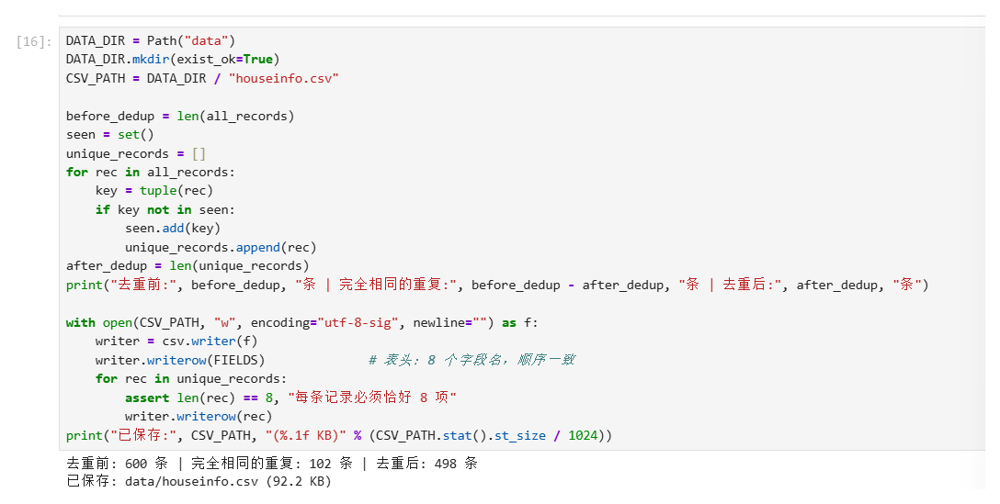

说明：8个字段的顺序是什么？按8个字段完全相同去重后，保存了多少条记录？

顺序为 title → house → address → struct → area → floor → maketime → price，与建表字段一致。采集 10 页共 600 条，按 8 个字段完全相同去重后剩余 498 条（重复 102 条），`csv.writer` 以 `utf-8-sig` 编码、`newline=""` 写入 `data/houseinfo.csv`；用 `csv.DictReader` 回读核对，数据行数 498（不含表头）。

## 第三阶段：MySQL 数据存储

### 1. 读取 CSV 并入库

本阶段读取第二阶段的 `data/houseinfo.csv`，不重新采集。

**截图：** 框出读取CSV、按8个字段整理入库参数的代码。

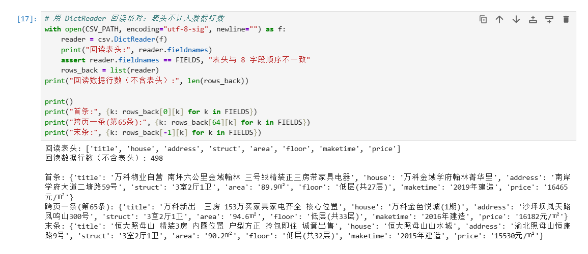

**截图：** 自己编写的入库代码。框出 `executemany()`、`commit()`、`rollback()`，以及关闭游标和连接的操作。另框出避免重复插入的代码。

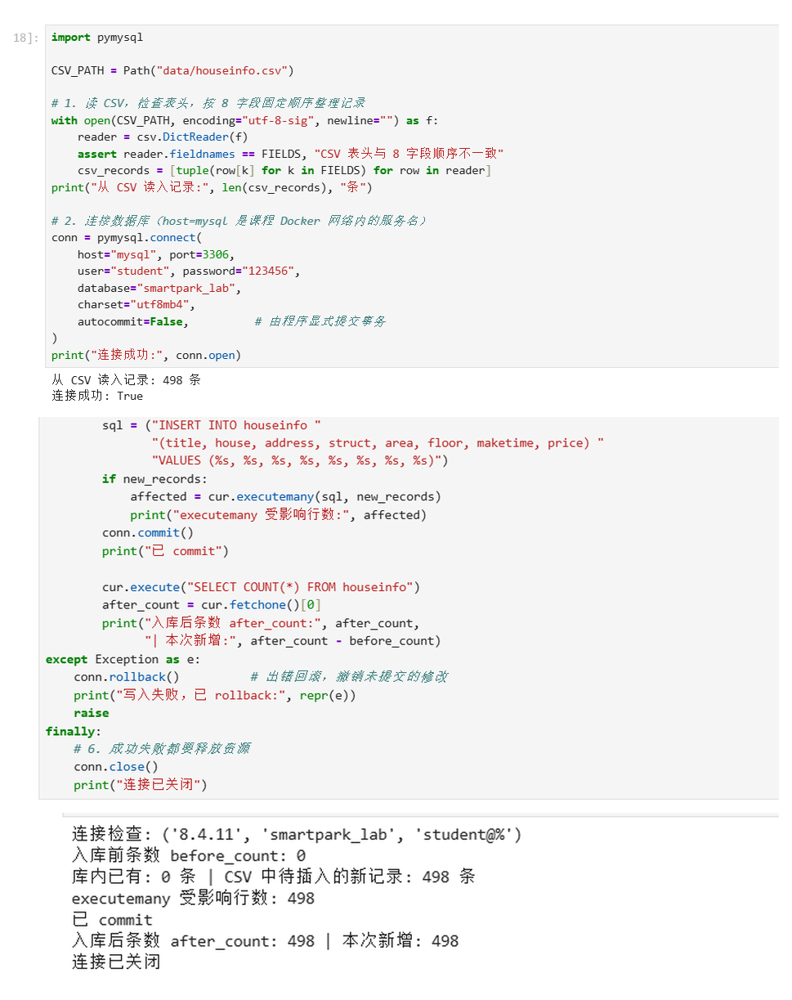

上图是首次入库（入库前 0 条 → 入库后 498 条，本次新增 498），下图是同一单元格在关闭程序后重建连接、独立重跑一次的结果：`SELECT` 出库内已有 498 条，`new_records` 为 0，`executemany` 未执行，`after_count` 仍为 498，本次新增 0。防重复插入的代码（`existing = set(cur.fetchall())`、`new_records = [t for t in csv_records if t not in existing]`）在第二张图的上半部分。

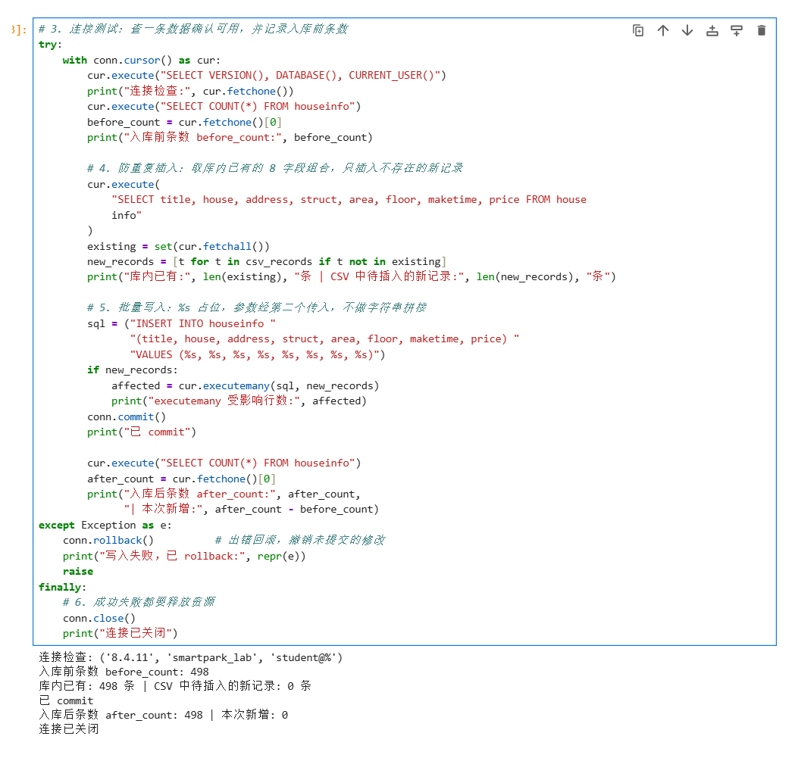

说明：每条记录怎样对应8个参数？成功、失败时分别做什么？再次运行时怎样避免重复插入？

INSERT 语句里写清 8 个字段名和 8 个 `%s` 占位，每条记录按 title→price 的固定顺序整理成 8 元组，经 `executemany(sql, records)` 的第二个参数传入，不做字符串拼接。成功后 `conn.commit()` 提交事务；任何一步出错则 `conn.rollback()` 撤销未提交的修改，并在 `finally` 中关闭游标和连接。重复运行时先 `SELECT` 库内已有的 8 字段组合存入集合，只插入 CSV 中不存在的记录，不清空表。

### 2. 核对结果

#### 查询条数和样本

**截图：** MySQL 终端中的入库前后 `SELECT COUNT(*)`、重跑后的条数，以及 `SELECT ... LIMIT 5` 的结果。

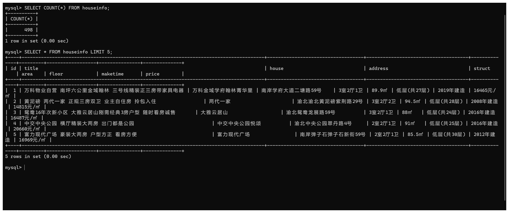

终端里 `SELECT COUNT(*)` 返回 498，与去重后的 CSV 行数一致；`LIMIT 5` 的 5 条明细中，标题、楼盘、地址、户型、面积、楼层、年代、单价都能正常显示中文（连接字符集设为 `utf8mb4`，否则控制台会把中文显示成问号）。入库前 0 条、入库后 498 条、重跑新增 0 条的完整输出见上一节的入库代码截图。

| 项目 | 实际结果 |
|---|---|
| 成功采集页数 | 10 |
| 采集记录数（去重前） | 600 |
| 完全相同的重复记录数 | 102 |
| CSV数据行数（不含表头） | 498 |
| 入库前条数 | 0 |
| 入库后条数 / 本次新增条数 | 498 / 498 |
| 关闭上次程序后，同批数据独立重跑的条数 / 新增条数 | 498 / 0 |
| 是否采集完整；未完成的原因 | 完整。末页"下一页"按钮已禁用（class 仅含 next，无 next-active），10 页全部采集 |

说明：首次入库后的条数应等于去重后的CSV数据行数，8个字段的内容也应一致。若不一致，说明原因。总条数以实际结果为准。

首次入库后表内 498 条，等于去重后 CSV 的 498 行，8 个字段内容也一致；关闭程序后重建连接、用同一批 CSV 独立重跑一次，库内已有 498 条、待插入 0 条、本次新增 0，条数仍是 498，说明防重复逻辑生效，也没有重复清空或重复写入。

#### 逐条核对

选取第一条、跨页一条和最后一条，比较网页、CSV与数据库中的8个字段。快照实验对照教师提供的网页文件。

**截图：** 三条样本的对照结果，框出面积、单价和年代。可分图。

下图左列从上到下是网页上的三条样本（第 1 页第 1 条、第 2 页第 5 条、第 10 页最后一条，第三张下方还能看到翻页条停在末页），右列是数据库中对应 `id = 1、65、498` 的三条记录；CSV 一侧的同一批字段见上一节 `DictReader` 回读输出的"首条 / 跨页一条（第65条）/ 末条"。

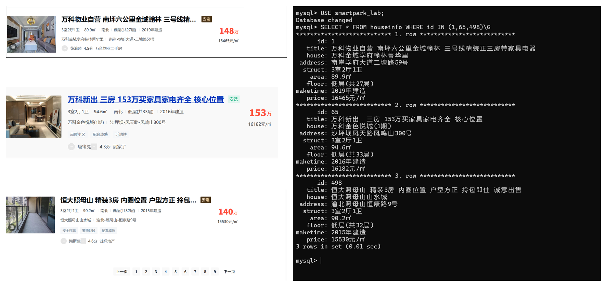

- 样本1（页码或URL、记录位置）：第 1 页第 1 条 —— title=万科物业自营 南坪六公里金域翰林 三号线精装正三房带家具电器，house=万科金域学府翰林菁华里，address=南岸学府大道二塘路59号，struct=3室2厅1卫，area=89.9㎡，floor=低层(共27层)，maketime=2019年建造，price=16465元/㎡
- 样本2（页码或URL、记录位置）：第 2 页第 5 条（CSV 第 65 行、库内 id=65）—— title=万科新出 三房 153万买家家具家电齐全 核心位置，house=万科金色悦城(1期)，address=沙坪坝凤天路凤鸣山300号，struct=3室2厅1卫，area=94.6㎡，floor=低层(共33层)，maketime=2016年建造，price=16182元/㎡
- 样本3（页码或URL、记录位置）：第 10 页最后 1 条（库内 id=498）—— title=恒大照母山 精装3房 内圈位置 户型方正 拎包即住 诚意出售，house=恒大照母山山水城，address=渝北照母山恒康路9号，struct=3室2厅1卫，area=90.2㎡，floor=低层(共32层)，maketime=2015年建造，price=15530元/㎡

核对结论及差异：

三条样本在网页、CSV 与数据库三处的 8 个字段逐一对照，标题、楼盘、地址、户型、面积、楼层、建造年代、单价全部一致，无差异。网页上另显示的总价（148万/153万/140万）不在采集字段内，属正常现象；面积、单价、年代在左列网页截图中均有原文可查。

## 问题与解决

- 遇到的问题、处理方法及结果（没有可写"无"）：
  1. 按手册示例用极简 UA（`Mozilla/5.0`）请求返回"访问验证-安居客"页（正文提示"系统检测到您正在使用网页抓取工具"）。对照浏览器实际请求，补全 User-Agent、Accept、Accept-Language 等完整请求头后正常返回列表页；采集代码中同时加入验证页检测，命中即中止并记录。
  2. 地址和户型的文字分散在多个 `` 中：地址用 `get_text(strip=True)` 按原有文字拼接、不插入空格；户型数字虽被拆进多个 span，`get_text` 同样能拼回"3室2厅1卫"。
  3. 属性组中朝向（"南北"）排在楼层前面，直接按下标取会把朝向当成楼层：改为按内容特征识别——含"㎡"是面积、含"层"是楼层、匹配 `^\d{4}年` 是建造年代，其余为朝向丢弃。
  4. 独立重跑入库单元格时报 `InterfaceError (0, '')`、末尾提示 `Error: Already closed`：该单元格 `finally` 中已执行 `conn.close()`，连接对象只能使用一次，直接复用必定失败。处理：先重新运行建连接的单元格（输出"连接成功: True"），紧接着运行入库单元格，重跑正常完成，新增 0 条。
- 尚未解决的问题、未完成的步骤（没有可写"无"）：无

## 思考题

1. 本次怎样实现下一页采集？结合自己的代码说明。

   每页解析后用 `soup.select_one("a.next")` 找到下一页按钮，`nxt.get("href")` 取得相对地址 `?page=N`，再用 `urljoin(当前页URL, href)` 补全成完整地址作为下一次请求目标。循环中用 `visited` 集合防止重复请求同一地址，用域名检查防止越出教学站，用 30 页上限和 1.2 秒间隔防死循环与请求过快；当按钮不存在或 class 不含 `next-active`（已禁用）时判定末页停止。

2. 旧代码把 out_list 定义在全局。你把结果列表放在哪里？为什么？

   我把结果列表 `all_records` 定义在采集主流程（分页循环所在单元）内部，解析函数 `parse_house` 只接收单条房源节点并返回 8 元组，不接触全局列表。这样解析函数无副作用、可单独测试；结果列表的生命周期限定在一次采集任务内，重复运行不会混入上一次的旧数据，避免了旧代码全局变量残留导致的重复记录。

3. 你怎样获取建造年代？节点缺失或顺序改变时，怎样处理？

   在房源属性组的文本项中用 `re.match(r"^\d{4}年", t)` 匹配"2019年建造"这类内容，匹配不到就把 maketime 置为空字符串，不报错也不跳过整条记录。因为按内容特征而不是列表下标取值，属性项顺序变化不影响结果；若整个属性组缺失，`info` 为 None 时各字段安全地取空值，不会抛 IndexError。

## 提交检查

- [x] 实验一原仓库的 `lab02/` 中已有源码、CSV、报告和真实截图。
- [x] 截图清楚，关键代码已框出，每项附有个人解释。
- [x] GitHub上能打开文件和图片，未上传个人账号密码、`.env`或教师答案。
- [ ] 未完成项已如实说明；学习通只交原仓库链接。

如使用 AI，简述它帮助了什么，以及自己修改、运行和核对了什么：

AI（WorkBuddy）帮助编写了解析函数、翻页循环、CSV 保存与 PyMySQL 入库代码，并实际执行了在线采集（10 页 600 条）与 CSV 生成。我本人完成：L05 更新包的解压、校验与镜像导入；在课程 JupyterLab 中运行 Notebook 并完成 MySQL 入库与验收；在 MySQL 终端建表、查询条数与样本；逐字段核对网页、CSV 与数据库中的三条样本；全部截图为本人操作截取。
