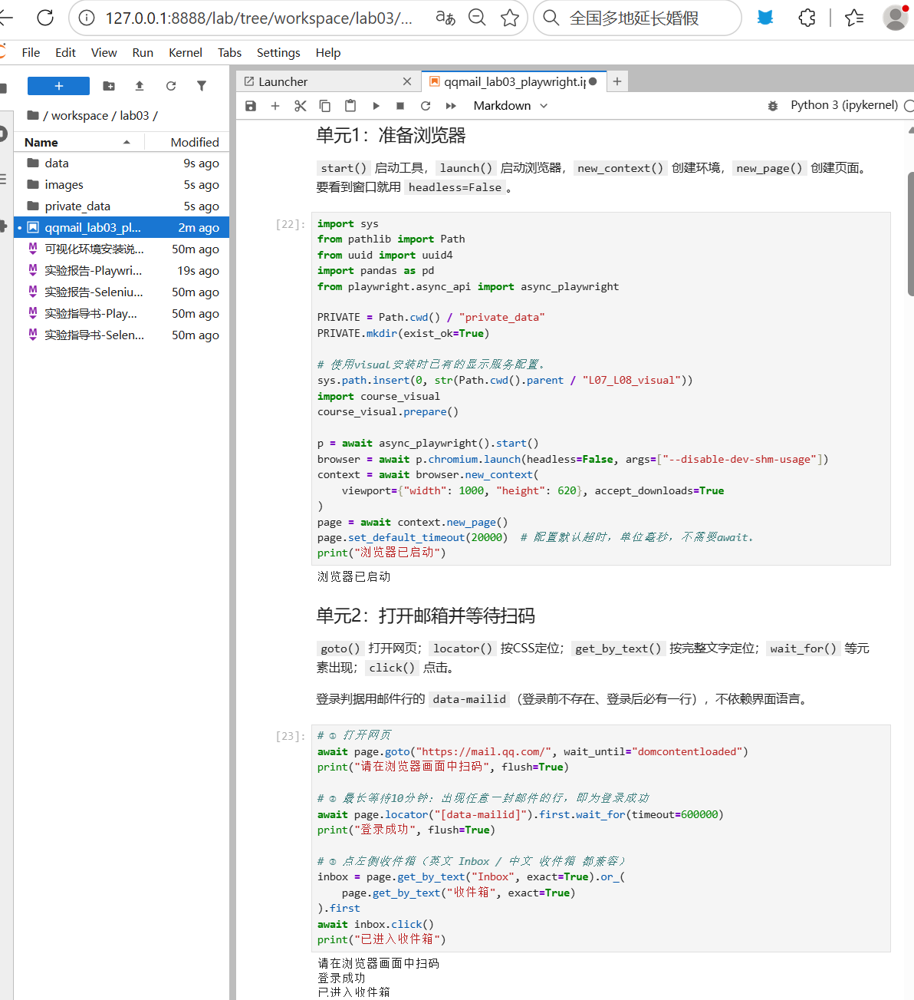
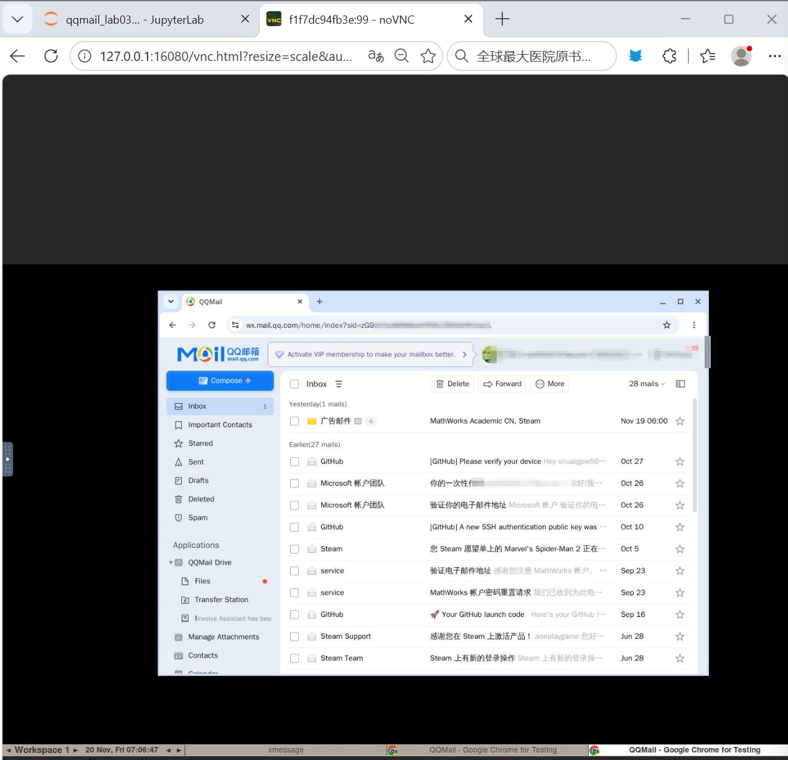
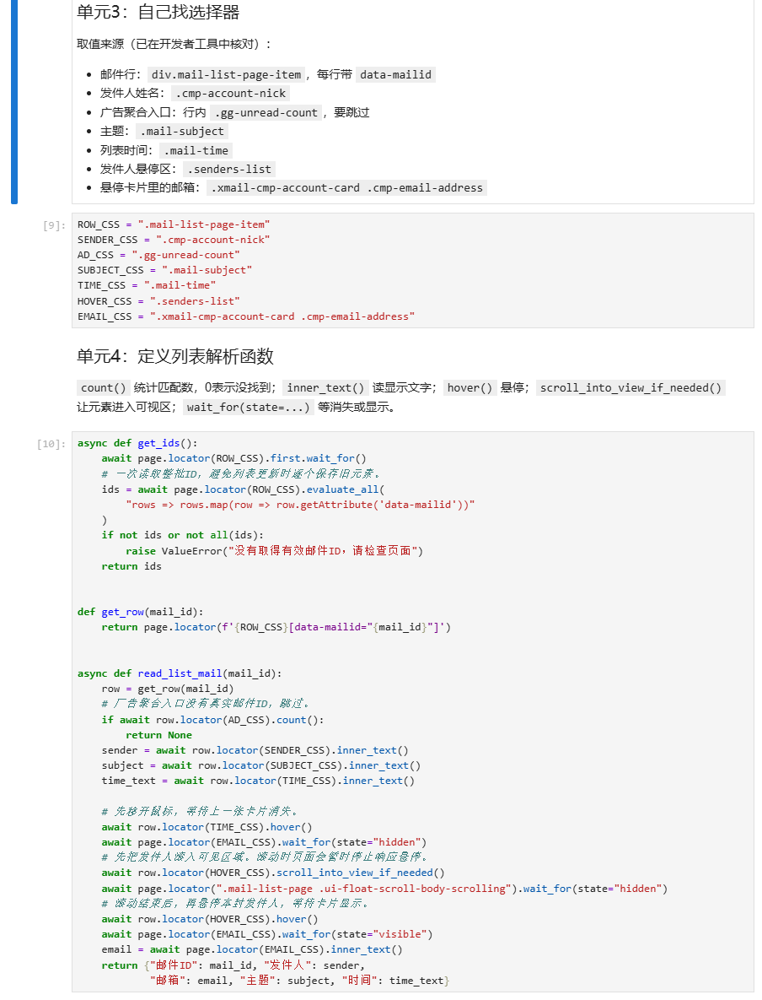
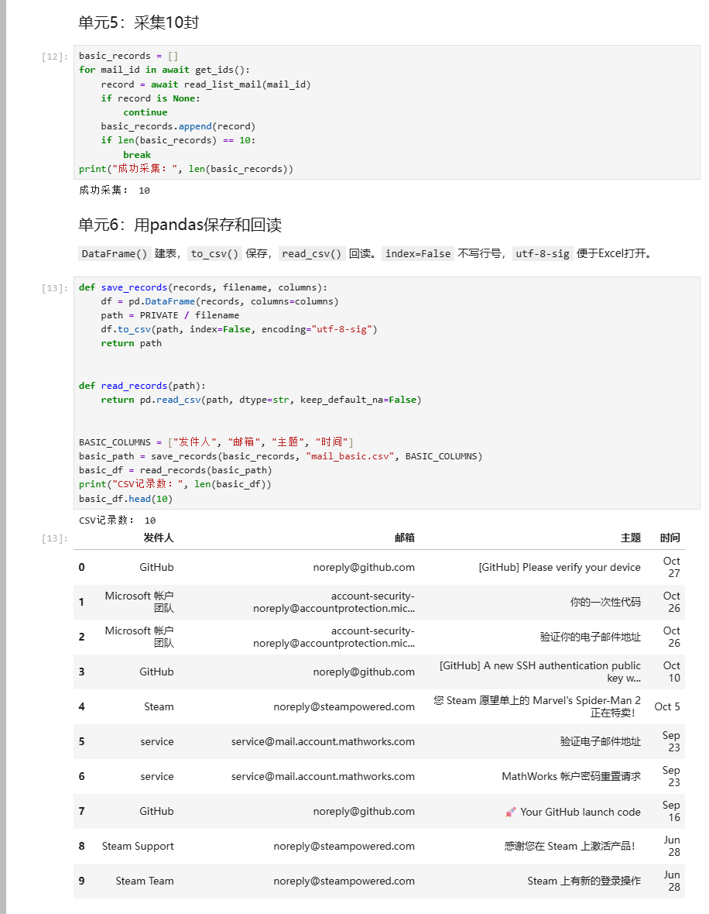
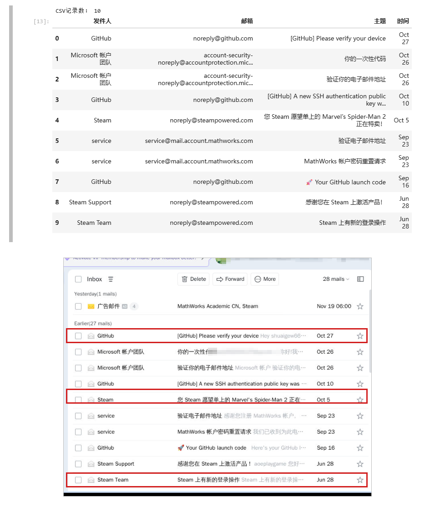
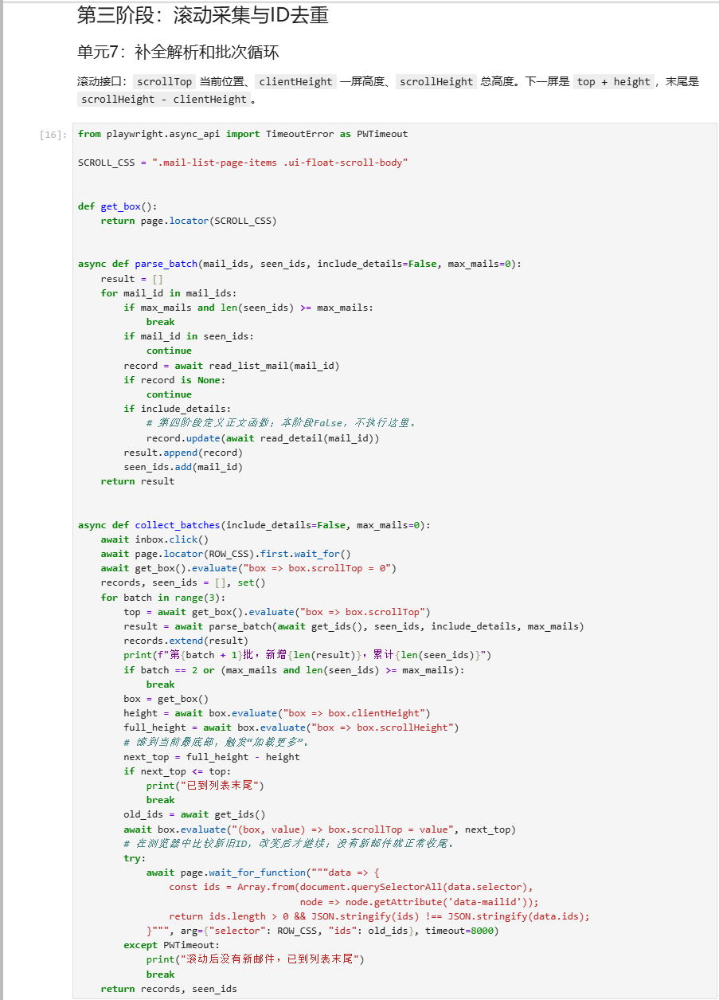
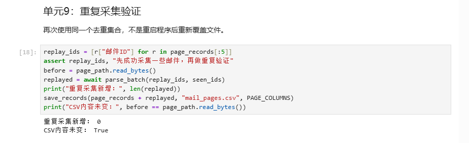
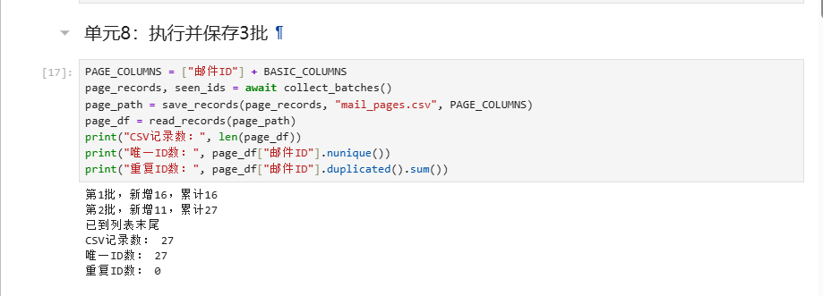
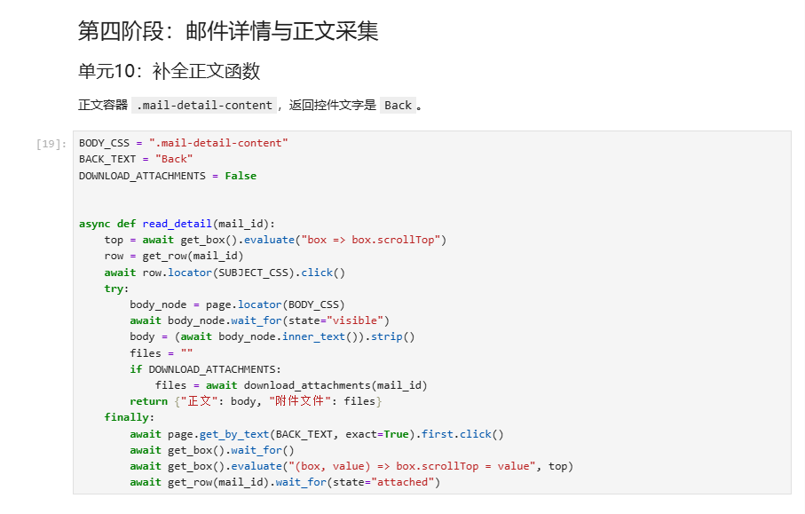
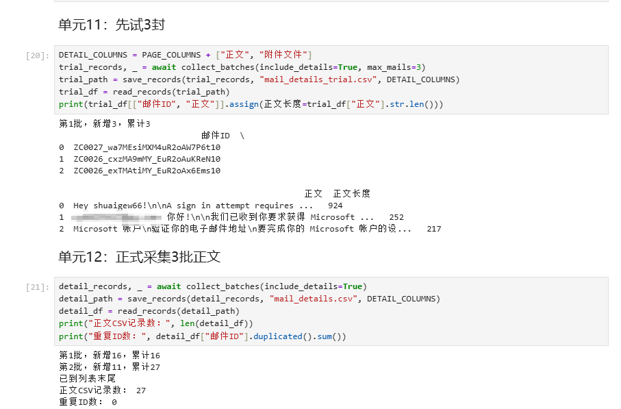

# 实验三报告：QQ邮箱采集（Playwright版）

- 班级：数据科学与大数据技术1241
- 姓名：王岩
- 学号：112404260120
- 第1—2课时实验日期：2026-11-20
- 第3—4课时实验日期：2026-11-20
- 第5—6课时实验日期：2026-11-20
- 第7—8课时实验日期：2026-11-20
- 所用工具：Playwright
- 工具版本与运行环境：Playwright 1.62.0 与容器内自带 Chromium；Python 3.12.3；Docker 课程环境 Ubuntu + JupyterLab
- 实验Notebook文件名：`qqmail_lab03_playwright.ipynb`
- GitHub原作业仓库链接：https://github.com/shuaigew66/bigdata-collection-labs-112404260120
- 数据来源（教师练习邮件 / 自备无敏感练习邮件 / 其他，说明）：自备 QQ 邮箱，仅用于本实验；公开 CSV 已脱敏

## 第一阶段：扫码登录（第1—2课时）

### 1. 环境和运行方式

**使用的启动脚本：** `start-course-visual.bat`（先安装 L07_L08 可视化增量包，再启动）

**运行位置：** Docker内JupyterLab的Notebook代码单元

**自己新建的Notebook文件名：** `qqmail_lab03_playwright.ipynb`

**所选工具版本：** Playwright 1.62.0，Chromium（容器镜像内置）

**启动或依赖问题及处理：** 可视化增量包用离线镜像方式导入（1.28GB，`offline-import`），安装日志确认"安装成功，原工作区未替换"；启动后 display 容器状态 healthy，VNC 端口 16080。浏览器能起来的前提是 Notebook 里先执行 `course_visual.prepare()` 设置 DISPLAY 与 XAUTHORITY。

**截图：** 环境成功运行和工具版本，注意遮挡可视化连接中的认证信息。

### 2. 扫码与登录判断

**人工完成的操作：** 在可视化画面里用手机扫码并确认登录

**登录成功控件的定位方式和选择器：** 邮件行 `div.mail-list-page-item` 的 `data-mailid` 属性，代码为 `page.locator("[data-mailid]").first`

**等待条件与最长等待时间：** `locator.wait_for(timeout=600000)`，最长等 10 分钟，元素一出现立即继续

**本次实际结果：** 扫码后数秒内识别到邮件行，输出"登录成功""已进入收件箱"，左侧导航显示 Inbox 未读数 9

**截图：** 登录判断代码和真实成功输出；若失败，附实际报错。

说明：程序如何区分"页面已打开"和"已经登录"？

答：登录页打开后，页面里没有任何 `data-mailid` 元素，只有二维码区域；扫码成功、收件箱列表渲染出来之后，邮件行才带上 `data-mailid`。所以判据是"只在登录后才存在的元素"，程序等到它就说明已登录。没有用固定 `sleep`，因为扫码耗时不可预测，固定等待要么白等要么提前超时。

## 第二阶段：采集10封邮件并保存CSV（第3—4课时）

### 1. 页面分析与字段提取

| 目标 | 实际使用的定位方式 | 取值方法 |
|---|---|---|
| 一封普通邮件 | CSS `.mail-list-page-item`，每行带 `data-mailid`（当前列表 17 行，含 1 行广告聚合） | 读 `data-mailid` 属性作唯一标识 |
| 发件人 | 行内 `.cmp-account-nick` | `inner_text()` |
| 发件人邮箱 | 悬停行内 `.senders-list` 后出现的浮层 `.xmail-cmp-account-card .cmp-email-address` | `inner_text()` |
| 主题 | 行内 `.mail-subject` | `inner_text()` |
| 列表时间 | 行内 `.mail-time` | `inner_text()` |

**如何识别并跳过聚合入口：** 聚合行是"广告邮件"，行内带 `.gg-unread-count`，其 `data-mailid` 是 `CAD000_...` 这种占位值。代码里 `await row.locator(AD_CSS).count()` 大于 0 就直接 `return None`，不计入结果。

**如何确保邮箱属于当前邮件，而不是上一封的卡片：** 分三步。先悬停本行 `.mail-time` 把鼠标从上一封的发件人移开，并等 `.cmp-email-address` 变为隐藏；再用 `scroll_into_view_if_needed()` 把本行发件人卷入可视区，等滚动中标记 `.ui-float-scroll-body-scrolling` 消失（滚动时页面暂停响应悬停）；最后才悬停本行 `.senders-list`，等卡片可见后取文字。

**截图：** 一封邮件的父容器、关键字段定位代码，以及正确解析的一条脱敏样本。

说明：选择一个字段，解释从页面节点到自己代码中选择器的过程。

答：以主题为例。在列表里右键一条邮件的标题选"检查"，Elements 面板定位到 ``；它位于邮件行 `div.mail-list-page-item` 内部，类名语义明确且每行只有一个，所以写成 `.mail-subject`。取值用 `inner_text()` 而不是 `text_content()`，因为要的是用户看到的文字，不需要隐藏节点。取的时候先限定在 `row.locator(...)` 里，保证是本行这一封，不会串到别的邮件。

### 2. CSV保存与回读

**原始CSV本地路径：** `private_data/mail_basic.csv`

**公开CSV路径：** `data/mail_basic_public.csv`

**实际表头：** `发件人,邮箱,主题,时间`

**成功采集的普通邮件数：** 10

**CSV回读数据行数（不含表头）：** 10

**是否为10条、每条4字段；若不符，说明原因：** 是，10 条 4 字段，无缺列

**截图：** 框出 `pd.DataFrame()`、`to_csv()`、`read_csv()`，以及 `index=False`、编码和条数统计。

### 3. 样本核对

| 样本 | 邮件位置或脱敏代号 | 发件人、邮箱、主题、时间是否一致 | 差异与处理 |
|---|---|---|---|
| 1 | 第1封 GitHub（Oct 27） | 一致：GitHub / noreply@github.com / [GitHub] Please verify your device / Oct 27 | 无 |
| 2 | 第5封 Steam（Oct 5） | 一致：Steam / noreply@steampowered.com / 愿望单特卖通知 / Oct 5 | 无 |
| 3 | 第10封 Steam Team（Jun 28） | 一致：Steam Team / noreply@steampowered.com / Steam 上有新的登录操作 / Jun 28 | 无 |

**截图：** 脱敏后的3条核对证据。

## 第三阶段：滚动采集与邮件ID去重（第5—6课时）

### 1. 滚动与等待

**滚动容器选择器：** `.mail-list-page-items .ui-float-scroll-body`（实测 scrollTop=0、clientHeight=512、scrollHeight=1238）

**每批开始位置如何记录：** `top = await get_box().evaluate("box => box.scrollTop")`

**下一屏位置如何计算：** `next_top = full_height - height`，即当前内容的真正底部，滚到这里才会触发"加载更多"

**怎样判断新一批已更新：** `page.wait_for_function` 在浏览器里比较滚动前后的 `data-mailid` 数组，序列化结果不同才算更新完成

**实际停止原因（完成3批 / 末尾 / 异常，说明）：** 到末尾。第 1、2 批共采到 27 封，第 2 批后滚到底已无新邮件，`wait_for_function` 捕获 `TimeoutError` 后打印"滚动后没有新邮件，已到列表末尾"并正常结束，第 3 批新增 0

**截图：** 滚动、等待列表ID变化、停止条件的代码与真实日志。

### 2. 邮件ID与去重

**邮件ID来自哪个属性：** 邮件行的 `data-mailid` 属性

**`seen_ids` 在哪里创建，怎样跨批次共用：** 在 `collect_batches()` 开头创建 `records, seen_ids = [], set()`，作为参数逐层传给 `parse_batch()`，3 个批次共用同一个集合

**ID何时加入集合：** 该封邮件成功解析并 `result.append(record)` 之后立即 `seen_ids.add(mail_id)`，跳过的广告行和被跳过的重复ID都不加入

**截图：** ID读取、重复跳过和集合更新代码。

| 批次 | 本批新增唯一邮件数 | 累计唯一邮件数 |
|---|---|---|
| 1 | 16 | 16 |
| 2 | 11 | 27 |
| 3 | 0 | 27 |

**原始CSV：** `private_data/mail_pages.csv`

**公开CSV：** `data/mail_pages_public.csv`

**CSV列数及表头（应为5列：邮件ID、发件人、邮箱、主题、时间）：** 5 列，`邮件ID,发件人,邮箱,主题,时间`

**CSV数据行数：** 27

**唯一ID数量：** 27

**重复ID数量：** 0

**在同一运行中重复采集已有批次，新增条数：** 0

**重复采集后，CSV是否增加记录：** 否，重写后字节完全相同（`CSV内容未变： True`）

**截图：** 回读数量、ID唯一性核对，以及同一次运行中重复采集新增0条的证据。

说明：为什么这项验证能证明去重，而仅仅关闭程序后重新覆盖CSV不能证明？

答：这次是把已经采过的前 5 个邮件ID 再喂给 `parse_batch`，而 `seen_ids` 还是同一个集合、同一次运行，函数里 `if mail_id in seen_ids: continue` 直接跳过，所以新增 0、CSV 字节不变。这说明去重发生在采集逻辑内部，是规则在起作用。反过来，如果关掉程序重新跑一遍再覆盖 CSV，文件里哪怕出现重复你也看不出来，那只是"重写了一次文件"，没有验证任何去重规则。

## 第四阶段：邮件详情与正文采集（第7—8课时）

### 1. 进入详情并返回

**试采CSV本地路径：** `private_data/mail_details_trial.csv`（仅本地核对，不要求提交）

**先行测试的3封邮件代号：** `ZC0027_wa7M…`、`ZC0026_cxzM…`、`ZC0026_exTM…`

**点击详情的定位方式：** `row.locator(".mail-subject").click()`

**正文容器选择器：** `.mail-detail-content`

**返回列表和恢复位置的方法：** `page.get_by_text("Back", exact=True).first.click()` 返回；返回后 `get_box().wait_for()` 等列表重新出现，再用 `box.scrollTop = top` 写回进入前记录的位置

**怎样重新定位滚动后的元素：** 不保存元素对象，每次用邮件ID拼 `[data-mailid="..."]` 重新 `get_row(mail_id)`，避免元素因重渲染而失效

**截图：** 进入详情、读取正文、返回和恢复列表位置的关键代码。

### 2. 接入批次循环并核对

**计划采集批次（通常3批；提前到末尾时说明）：** 计划 3 批，实际第 2 批后已到列表末尾，共 27 封

**正文CSV列数及表头（应为7列：邮件ID、发件人、邮箱、主题、时间、正文、附件文件）：** 7 列，`邮件ID,发件人,邮箱,主题,时间,正文,附件文件`

**实际保存正文记录数：** 27

**有可见文字的正文数：** 27

**空正文或失败数及原因：** 0

**与阶段3邮件ID范围不同的原因（相同时写"一致"）：** 一致

**原始CSV：** `private_data/mail_details.csv`

**公开CSV：** `data/mail_details_public.csv`

| 样本 | 邮件代号 | 正文实际字符数 | 与详情可见文字是否一致 | 返回后能否继续 |
|---|---|---|---|---|
| 1 | ZC0027_wa7M… | 924 | 一致 | 能 |
| 2 | ZC0026_cxzM… | 252 | 一致 | 能 |
| 3 | ZC0026_exTM… | 217 | 一致 | 能 |

**截图：** CSV回读数量、正文长度及脱敏后的正文核对样本。不要展示私人正文原文。

说明：怎样确认保存的是正文，而不是主题、摘要或整个页面？正文含换行时怎样统计邮件记录数？

答：容器选的是 `.mail-detail-content`，它是详情页正文区的唯一节点，主题在工具栏和列表行的 `.mail-subject` 里，摘要 `.mail-digest` 只在列表页出现，三者不会混。取完 `inner_text()` 再和详情页可见文字逐字比对。正文里有换行时不能数文本行，要用 `len(df)` 统计 DataFrame 的记录数，因为 CSV 里被引号包裹的换行只是一个字段内部的内容，不算新记录。

### 3. 选做：附件下载

**是否选做：** 未选做

**选做试采CSV：** `private_data/mail_attachments_trial.csv`（未生成）

**使用的无敏感练习附件类型：** 无

**成功下载文件数：** 0

**文件大小及完成状态：** 无

**没有附件的邮件如何处理：** 未启用附件下载，`DOWNLOAD_ATTACHMENTS` 保持 False，正文CSV的"附件文件"列全部为空字符串

## 问题与解决

**遇到的问题、定位过程、修改及实测结果（没有可写"无"）：**

1. 单元2 卡在 `[*]` 不结束。定位过程：单元里用 `get_by_text("收件箱", exact=True)` 等元素，但本机邮箱界面是英文，左侧导航文字是 `Inbox`，所以永远等不到。修改：判据换成 `page.locator("[data-mailid]").first.wait_for(timeout=600000)`，与界面语言无关。实测扫码后数秒通过。

2. 中断卡住的单元后，`page` 对象失效，报 `Connection closed while reading from the driver`。原因：中断 `wait_for` 时 Playwright 的 driver 连接被一起掐断。处理：重跑单元1 创建新浏览器，重新扫码。

3. 单元8 第 3 批报 `wait_for_function` 超时。定位：前两批已采 27 封，滚动后 `data-mailid` 数组不再变化，说明列表已到底。修改：把滚动位置从"下一屏"改成"当前最底部 `scrollHeight - clientHeight`"以触发加载更多，并用 `try/except PWTimeout` 兜底，没有新邮件就打印"已到列表末尾"正常收尾。实测第 3 批新增 0，整体不报错。

**尚未解决的问题或未完成步骤（没有可写"无"）：** 附件下载为选做，本次未做。

## 思考题

1. 人工扫码完成了什么？程序如何判断已经登录？为什么不能只用固定等待？

   答：人工扫码完成了身份认证，把"未登录的浏览器"变成"有登录态的浏览器"，这一步自动化做不了也不该做（涉及账号安全）。程序判断登录靠元素出现：登录前页面里没有 `data-mailid`，登录后收件箱列表渲染出来才有，`wait_for` 等到它就继续。不能只用固定等待，因为扫码耗时完全不可控，等短了会提前失败，等长了白浪费，而且页面慢的时候依然会错。

2. 为什么按邮件ID去重，而不按发件人或主题？结合自己的实测说明。

   答：`data-mailid` 是服务器给每封邮件的唯一编号，实测 27 条记录对应 27 个不同ID，一对一。发件人和主题会重复：我的结果里 GitHub 发了 3 封、Steam 系 3 封，主题也有重复的（两封 Microsoft 验证邮件主题接近）。如果按发件人去重，27 封会被压成几个；按主题去重，同主题的不同邮件会被误丢。

3. 列表摘要和详情正文有什么区别？返回列表后如何避免失效元素和漏采？

   答：列表摘要只有发件人、主题、时间和一小段 `.mail-digest`，是服务器为列表页准备的截断文本；正文在 `.mail-detail-content` 里，只有打开详情才渲染，内容完整且带格式。返回列表后不保留旧的元素对象，因为 DOM 重渲染会让旧引用失效，统一用 `get_row(mail_id)` 按ID重新定位；同时把进入前的 `scrollTop` 写回去，保证列表停在原位置，不会因为回到顶部而重复采或漏采。

4. 结合所选工具，说明一次真实问题的定位与修改。若使用AI，写明哪些建议经过自己的运行核对。

   答：单元8 第 3 批的 `wait_for_function` 超时。定位过程：看前两批日志是 16 和 11，累计 27，说明邮件数可能已到底；再检查代码，等待条件是"滚动后 `data-mailid` 数组必须变化"，到底时永远不会变化，只能等满超时。修改：滚动位置改成 `scrollHeight - clientHeight` 真正触底，并加 `try/except` 把"没有新邮件"当成正常结束。实测打印"滚动后没有新邮件，已到列表末尾"，第 3 批新增 0，后续单元9 去重验证仍然通过。这个判断和改法我在自己的环境里跑过并核对了结果。

数据和截图的脱敏方法；各CSV之间怎样保持ID及字段对应关系：

脱敏方法：正文和主题里的本人邮箱替换为 `wx***@qq.com`，6—8 位连续数字（验证码、一次性代码）统一替换为 `******`，其余保留；截图时遮挡登录二维码、账号昵称和验证码。

三份CSV的对应关系：`mail_pages.csv` 与 `mail_details.csv` 都以 `邮件ID`（`data-mailid`）为主键，`mail_details.csv` 的前 5 列与 `mail_pages.csv` 完全一致，只在其后追加"正文""附件文件"两列；`mail_basic.csv` 是第二阶段的前 10 封，其记录是 `mail_pages.csv` 前 10 条的子集（同发件人、同邮箱、同主题、同时间）。三份文件均为 0 重复ID。

如使用AI，简述它帮助了什么，以及自己编写、修改、运行和核对了什么：

AI 帮助定位页面结构（给出各字段的 CSS 选择器候选）和排查报错（`wait_for_function` 超时、`Connection closed`）。所有代码都在本人的课程 JupyterLab 中实际运行：扫码、采集10封、滚动3批、27封正文均由本人执行并核对；选择器逐条在开发者工具里确认后才写入；第 3 批超时的修法和去重验证结论都经过本人重跑复现。
